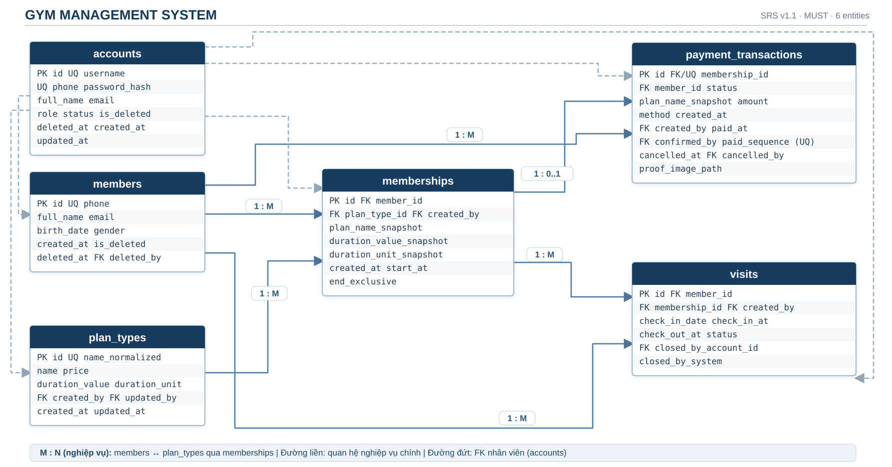
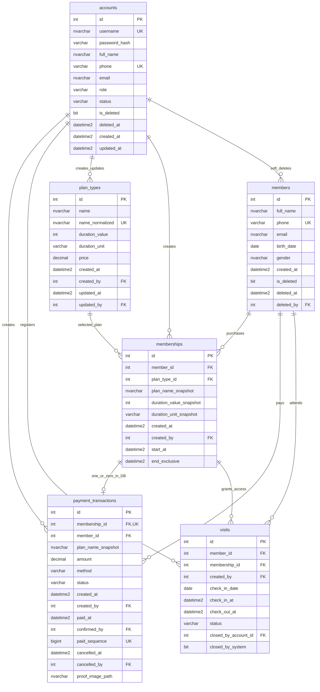

# THIẾT KẾ CƠ SỞ DỮ LIỆU – GYM MANAGEMENT SYSTEM

**Bản tài liệu:** R3 – hiệu đính cuối sau review 9.1/10 (21/10/2026); không thay đổi phạm vi nghiệp vụ  
**Đối chiếu:** `docs/Software Requirement Specification.md` — Baseline 1.1; `docs/sql_scripts/GymDB_Full_Setup.sql`; các model, DAO và enum trên nhánh `main` của repository `MrDonut12/gym-management`; Implementation Task Board T01–T20  
**Phạm vi:** Must | **DBMS:** Microsoft SQL Server 2022  
**Trạng thái xác minh:** Đã đối chiếu *tĩnh* SRS v1.1, SQL setup và Java skeleton trong repository; các tên cột, CHECK và mismatch DAO được ghi nhận từ mã nguồn. **Chưa có bằng chứng chạy script trên SQL Server 2022, đăng nhập seed hoặc integration test.** Tài liệu này không thay thế script hiện có.

> **Phạm vi FUT-04 đã xác minh trong SRS trên repository:** Bảo vệ hai Payment Transaction khác nhau của cùng hội viên khi xác nhận PAID đồng thời là FUT-04 (hoãn). Must vẫn yêu cầu chống xác nhận lặp cùng một giao dịch, xử lý nguyên tử PAID + lịch và xếp chuỗi không chồng lấn đối với các xác nhận tuần tự.


# 1. Kết quả rà soát và phạm vi hiệu chỉnh

Bản trước bám SRS Baseline 1.0, có 8 bảng và nghiệp vụ đã chuyển sang FUT. Bản này chỉ mô tả các phần thuộc Must của kế hoạch triển khai v1.1.

| Nội dung | Bản cũ | Bản sửa theo v1.1 |
| --- | --- | --- |
| Phạm vi | 8 bảng | 6 bảng: accounts, members, plan_types, memberships, payment_transactions, visits |
| Bảng không còn Must | VisitChanges, AuditLogs | Loại khỏi schema Must; không triển khai trong T01 |
| Tên bảng | MembershipPlans; Transactions | plan_types; payment_transactions |
| Tên cột trọng yếu | paid_seq; visit_date | paid_sequence; check_in_date |
| Sửa/hủy lượt | CN-16 và lịch sử thay đổi | Không triển khai; FUT-01 |
| Tự đóng lúc 20:00 | Job nền + xử lý lúc khởi động | Đóng lười khi có request; job/timer thuộc FUT-02 |
| Ngày bắt đầu PAID | Cho chọn ngày tương lai | Không có form chọn ngày; FUT-03 |
| Sơ đồ ERD | 8 thực thể | 6 thực thể; sơ đồ tổng quan SVG vector và sơ đồ Mermaid chi tiết có thể chỉnh sửa |
| Đồng thời xác nhận PAID | Bắt buộc khóa cả hai giao dịch khác nhau cùng hội viên | Đồng thời khác giao dịch: tăng cường, thuộc FUT-04; chống xác nhận trùng một giao dịch: Must |
| Thứ tự `paid_sequence` | Dễ hiểu nhầm là thứ tự COMMIT | Số cấp duy nhất, không bảo đảm trùng thứ tự COMMIT của các transaction đồng thời |

Nguyên tắc tương thích: không sửa model, enum, exception hay public method signature đã đóng băng nếu chưa qua quy trình PR/phân công. Đã xác nhận tên cột `plan_type_id`, `paid_sequence`, `check_in_date` từ SQL và model. Những chỗ DAO TODO dùng tên cột khác được liệt kê ở mục 10; không đổi tên cột trong SQL một cách đơn phương.

# 2. Mô hình dữ liệu và mối quan hệ

## 2.1. Sáu bảng thuộc Must

| Bảng | Vai trò | Chủ đề/owner |
| --- | --- | --- |
| accounts | Đăng nhập, nhân viên, 5 vai trò, xóa mềm | T01 + T07/T08 |
| members | Hồ sơ hội viên, tra cứu, xóa mềm | T01 + T10 |
| plan_types | 4 loại gói cố định, cấu hình tên/giá | T01 + T12 |
| memberships | Đăng ký PENDING và thời hạn sau PAID | T01 + T13 |
| payment_transactions | Snapshot số tiền, trạng thái, paid_sequence | T01 + T15 |
| visits | Check-in/check-out, auto-close lười | T01 + T17 |

## 2.2. ERD logic tổng quan và cardinality



*Hình 1. ERD **tổng quan** của 6 bảng Must; chỉ hiện các khóa, thuộc tính tiêu biểu và quan hệ chính. Các cạnh nét đứt từ `accounts` mô tả FK liên quan nhân viên. Danh mục cột chính xác, NULL/NOT NULL, UNIQUE và CHECK phải xem tại `docs/sql_scripts/GymDB_Full_Setup.sql`; hình SVG không thay cho schema đầy đủ.*

**Phân biệt mức dữ liệu và nghiệp vụ:** `UNIQUE(payment_transactions.membership_id)` cùng FK bảo đảm **mỗi Membership có tối đa một Payment Transaction** (`1 : 0..1` khi nhìn riêng constraint DB). Để bảo đảm **mỗi Membership được tạo thành công có đúng một Payment Transaction** (`1 : 1` nghiệp vụ), T13/T15 phải INSERT cả hai trong một database transaction và rollback nếu một INSERT lỗi. SQL Server không tự bảo đảm vế “ít nhất một” bằng UNIQUE/FK đơn lẻ.

**Quan hệ M:N nghiệp vụ:** Nhiều `members` có thể đăng ký nhiều `plan_types`, và một loại gói có thể được nhiều người mua. Hai cạnh `members 1:M memberships` và `plan_types 1:M memberships` thực hiện quan hệ này, không có FK M:N trực tiếp.

| Thực thể cha | Thực thể con | Cardinality dữ liệu | Cơ chế |
| --- | --- | --- | --- |
| members | memberships | 1 : 0..M | `memberships.member_id` FK NOT NULL |
| plan_types | memberships | 1 : 0..M | `memberships.plan_type_id` FK NOT NULL |
| memberships | payment_transactions | **1 : 0..1** tại DB; **1:1** sau transaction tạo thành công | `payment_transactions.membership_id` FK NOT NULL + UNIQUE; service INSERT nguyên tử |
| members | payment_transactions | 1 : 0..M | `member_id` lưu cùng hội viên; composite FK |
| members | visits | 1 : 0..M | `visits.member_id` FK; unique filtered index chặn >1 OPEN |
| memberships | visits | 1 : 0..M | `visits.membership_id` FK + composite FK cùng member |
| accounts | payment_transactions | 1 : 0..M | FK `created_by`, `confirmed_by`, `cancelled_by` (hai FK sau nullable) |
| accounts | visits | 1 : 0..M | FK `created_by`, `closed_by_account_id` (nullable) |

**Sơ đồ tham khảo cho GitHub:** Mermaid liệt kê các trường dữ liệu và cạnh FK quan trọng, gồm FK từ `accounts` đến các bảng nghiệp vụ. Mermaid giúp chỉnh sửa cấu trúc; đối với khai báo đầy đủ từng constraint và nullability, lấy `GymDB_Full_Setup.sql` làm nguồn chuẩn. Word nhúng SVG vector (có ảnh JPG dự phòng để tương thích phiên bản Word cũ):



*Đã đối chiếu:* `memberships.plan_type_id` xuất hiện trong script SQL và khớp trường `Membership.planTypeId` của skeleton. Tên cột này không còn là giả định.

# 3. Đặc tả sáu bảng dữ liệu

## 3.1. accounts – tài khoản và nhân viên

| Cột | Kiểu tham khảo | Quy tắc |
| --- | --- | --- |
| id | INT IDENTITY | PK |
| username | NVARCHAR(50) | NOT NULL, UNIQUE không phân biệt hoa/thường |
| password_hash | VARCHAR(255) | Hash PBKDF2/BCrypt theo định dạng T07 thống nhất |
| full_name | NVARCHAR(100) | NOT NULL, 2–100 ký tự |
| phone | VARCHAR(10) | NOT NULL, đúng 10 chữ số, UNIQUE trong accounts |
| email | NVARCHAR(254) | NULL, không cần UNIQUE |
| role | VARCHAR(20) | Năm vai trò cố định |
| status | VARCHAR(10) | ACTIVE hoặc LOCKED |
| is_deleted / deleted_at | BIT / DATETIME2(0) | Xóa mềm, không DELETE vật lý |
| created_at / updated_at | DATETIME2(0) | Thời gian Việt Nam |

Không cần bảng session, roles động hay cookie: phiên trong HttpSession/JSESSIONID, cookie gym_username chỉ ghi nhớ tên đăng nhập (T05, T07). RBAC thực hiện ở backend.

## 3.2. members – hồ sơ hội viên

| Cột | Kiểu | Quy tắc |
| --- | --- | --- |
| id | INT IDENTITY | PK, mã hiển thị sinh từ id |
| full_name | NVARCHAR(100) | NOT NULL, 2–100 ký tự |
| phone | VARCHAR(10) | NOT NULL, UNIQUE, biểu thức ^0\d{9}$ |
| email | NVARCHAR(254) | NULL, đúng định dạng nếu nhập |
| birth_date | DATE | NULL, không sau hôm nay (backend) |
| gender | NVARCHAR(10) | NULL, Nam/Nữ/Khác |
| created_at | DATETIME2(0) | NOT NULL, không đổi, báo cáo hội viên mới |
| is_deleted | BIT | NOT NULL, mặc định 0 |
| deleted_at / deleted_by | DATETIME2(0) / INT | NULL, FK accounts cho người xóa |

Xóa mềm không tự hủy giao dịch PENDING hiện có. Hội viên đã xóa mềm không tạo PENDING mới, không xác nhận PAID và không check-in; PENDING cũ có thể hủy thủ công (T10, T15).

## 3.3. plan_types – bốn loại gói

| Cột | Kiểu | Quy tắc |
| --- | --- | --- |
| id | INT IDENTITY | PK |
| name / name_normalized | NVARCHAR(100) | Tên hiển thị; tên chuẩn hóa UNIQUE, cập nhật cùng nhau |
| duration_value | INT | 1 hoặc 6 theo tổ hợp hợp lệ; không sửa sau tạo |
| duration_unit | VARCHAR(10) | DAY/MONTH/YEAR |
| price | DECIMAL(12,0) | Số nguyên dương |
| created_at / created_by | DATETIME2(0) / INT | NOT NULL, FK account Owner |
| updated_at / updated_by | DATETIME2(0) / INT | NULL, chỉ sửa tên/giá theo RBAC |

Chỉ bốn tổ hợp (1 DAY), (1 MONTH), (6 MONTH), (1 YEAR), không thêm thời hạn khác. Không có xóa/ngừng dùng gói. Mọi Membership đã tạo phải giữ snapshot tên/thời hạn/giá cũ khi gói bị đổi tên/giá.

## 3.4. memberships – đăng ký gói và lịch PAID

| Cột | Kiểu | Quy tắc |
| --- | --- | --- |
| id | INT IDENTITY | PK |
| member_id | INT | FK members, NOT NULL |
| plan_type_id | INT | FK plan_types, NOT NULL; khớp SQL và model `planTypeId` |
| plan_name_snapshot | NVARCHAR(100) | Bản chụp tên gói khi tạo PENDING |
| duration_value_snapshot | INT | Bản chụp thời hạn, > 0 |
| duration_unit_snapshot | VARCHAR(10) | DAY/MONTH/YEAR |
| created_at / created_by | DATETIME2(0) / INT | Thời điểm và nhân viên tạo PENDING |
| start_at | DATETIME2(0) | NULL khi PENDING/CANCELLED; 00:00 khi PAID |
| end_exclusive | DATETIME2(0) | NULL khi PENDING/CANCELLED; > start_at khi PAID |

Không có requested_start_date: ngày bắt đầu không do người dùng chọn trong Must (FUT-03). Tình trạng từng đăng ký suy ra từ payment_transactions.status và thời điểm hiện tại; không tạo enum membership_state mới.

## 3.5. payment_transactions – thanh toán thủ công

| Cột | Kiểu | Quy tắc |
| --- | --- | --- |
| id | INT IDENTITY | PK, mã giao dịch hiển thị sinh từ id |
| membership_id | INT | FK memberships, UNIQUE, NOT NULL |
| member_id | INT | FK members, khớp memberships.member_id |
| plan_name_snapshot | NVARCHAR(100) | Bản chụp từ đăng ký, giữ nguyên |
| amount | DECIMAL(12,0) | Snapshot giá, >0, không tính lại |
| method | VARCHAR(15) | CASH hoặc BANK_TRANSFER |
| status | VARCHAR(10) | PENDING, PAID, CANCELLED |
| created_at / created_by | DATETIME2(0) / INT | Thời điểm/người tạo PENDING |
| paid_at / confirmed_by | DATETIME2(0) / INT | Chỉ có khi PAID |
| paid_sequence | BIGINT | NULL khi chưa PAID; cấp từ SEQUENCE, UNIQUE |
| cancelled_at / cancelled_by | DATETIME2(0) / INT | Chỉ có khi CANCELLED |
| proof_image_path | NVARCHAR(500) | Ảnh minh chứng tùy chọn, không xác nhận tiền |

Mỗi Membership được tạo thành công có đúng một giao dịch nhờ service T13/T15 tạo nguyên tử; FK + UNIQUE chỉ bảo đảm **tối đa một** giao dịch trên mỗi Membership. PAID không sửa, hủy, hoàn tiền. Quyền xác nhận/hủy thuộc Manager và Receptionist. Ảnh minh chứng không tự xác nhận tiền đã nhận.

## 3.6. visits – lượt tập

| Cột | Kiểu | Quy tắc |
| --- | --- | --- |
| id | INT IDENTITY | PK |
| member_id / membership_id | INT / INT | FK member và Membership cùng hội viên |
| created_by | INT | FK accounts; người tạo lượt |
| check_in_date | DATE | Ngày check-in theo giờ Việt Nam |
| check_in_at | DATETIME2(0) | Giờ vào, 07:00 ≤ time < 20:00 |
| check_out_at | DATETIME2(0) | NULL khi OPEN; lúc ra/tự đóng khi kết thúc |
| status | VARCHAR(12) | OPEN / COMPLETED / AUTO_CLOSED (Must) |
| closed_by_account_id | INT | NULL nếu chưa đóng hoặc đóng bởi hệ thống |
| closed_by_system | BIT | 1 nếu đóng lười đúng 20:00, ngược lại 0 |

Không có thao tác EDIT/CANCEL trên lượt và không có bảng VisitChanges trong Must (FUT-01). Không tạo job/timer tự đóng (FUT-02). Có thể dùng kiểm soát đồng thời ở tầng DAO/DB, nhưng không tự ý thêm field vào model đã đóng băng.

# 4. SQL Server 2022 — ràng buộc nội bảng và chỉ mục

Đoạn SQL trong mục 4 là **ví dụ đối chiếu thiết kế**, không phải script migration chạy trực tiếp. Repository đã có `docs/sql_scripts/GymDB_Full_Setup.sql` với `CREATE TABLE`, FK, UNIQUE, CHECK, DEFAULT, index và dữ liệu mẫu. Nhiều ràng buộc của mục này **đã tồn tại** trong script: chạy thêm `ALTER TABLE` có thể báo tên trùng. T01 nên kiểm tra bản SQL hiện có và sửa tại nguồn thay vì copy toàn bộ ví dụ bên dưới. Với mọi cột bắt buộc, dùng `NOT NULL` trong `CREATE TABLE`; chỉ `CHECK(amount > 0)` chưa đủ chặn NULL.

## 4.1. CHECK: tài khoản, hội viên, loại gói

```sql
ALTER TABLE accounts ADD CONSTRAINT CK_Accounts_Role CHECK (
    role IN ('ADMINISTRATOR','OWNER','MANAGER','RECEPTIONIST','ACCOUNTANT'));
ALTER TABLE accounts ADD CONSTRAINT CK_Accounts_Status CHECK (
    status IN ('ACTIVE','LOCKED'));

-- Tránh chuỗi 10 ký tự nhưng không phải chữ số.
ALTER TABLE accounts ADD CONSTRAINT CK_Accounts_Phone CHECK (
    DATALENGTH(phone) = 10 AND
    phone COLLATE Latin1_General_BIN2 NOT LIKE '%[^0-9]%');
ALTER TABLE members ADD CONSTRAINT CK_Members_Phone CHECK (
    DATALENGTH(phone) = 10 AND LEFT(phone,1)='0' AND
    phone COLLATE Latin1_General_BIN2 NOT LIKE '%[^0-9]%');

ALTER TABLE plan_types ADD CONSTRAINT CK_PlanTypes_Price CHECK (price > 0);
ALTER TABLE plan_types ADD CONSTRAINT CK_PlanTypes_Duration CHECK (
    (duration_value=1 AND duration_unit='DAY') OR
    (duration_value=1 AND duration_unit='MONTH') OR
    (duration_value=6 AND duration_unit='MONTH') OR
    (duration_value=1 AND duration_unit='YEAR'));
ALTER TABLE plan_types ADD CONSTRAINT UQ_PlanTypes_Duration
    UNIQUE(duration_value, duration_unit);
```

Các UNIQUE khác (`accounts.username`, `accounts.phone`, `members.phone`, `plan_types.name_normalized`) phải được khai báo trong DDL chính. `username` và `name_normalized` phải dùng collation không phân biệt hoa/thường; `name_normalized` được tính và cập nhật đồng bộ với `name` ở service.

## 4.2. CHECK: Membership và Payment Transaction

```sql
ALTER TABLE memberships ADD CONSTRAINT CK_Memberships_Period CHECK (
    (start_at IS NULL AND end_exclusive IS NULL) OR
    (start_at IS NOT NULL AND end_exclusive IS NOT NULL
       AND end_exclusive > start_at
       AND CAST(start_at AS time) = '00:00:00'));
ALTER TABLE memberships ADD CONSTRAINT CK_Memberships_Duration CHECK (
    duration_value_snapshot > 0
    AND duration_unit_snapshot IN ('DAY','MONTH','YEAR'));

ALTER TABLE payment_transactions ADD CONSTRAINT CK_Payment_Amount
    CHECK (amount > 0);
ALTER TABLE payment_transactions ADD CONSTRAINT CK_Payment_Method
    CHECK (method IN ('CASH','BANK_TRANSFER'));
ALTER TABLE payment_transactions ADD CONSTRAINT CK_Payment_State CHECK (
    (status = 'PENDING'
     AND paid_at IS NULL AND confirmed_by IS NULL
     AND paid_sequence IS NULL
     AND cancelled_at IS NULL AND cancelled_by IS NULL)
    OR
    (status = 'PAID'
     AND paid_at IS NOT NULL AND confirmed_by IS NOT NULL
     AND paid_sequence IS NOT NULL
     AND cancelled_at IS NULL AND cancelled_by IS NULL)
    OR
    (status = 'CANCELLED'
     AND paid_at IS NULL AND confirmed_by IS NULL
     AND paid_sequence IS NULL
     AND cancelled_at IS NOT NULL AND cancelled_by IS NOT NULL));
```

`CK_Payment_State` vừa giới hạn trạng thái trong `PENDING / PAID / CANCELLED`, vừa kiểm tra các trường phụ thuộc; không cần CHECK enum riêng nếu ràng buộc trên đã hoạt động và `status NOT NULL`. Nó **không tự ngăn** sửa PAID sang trạng thái khác nếu cập nhật đồng thời tất cả cột để tạo trạng thái hợp lệ. Phải giới hạn thao tác ghi ở service/DB privilege hoặc stored procedure/trigger theo CN-25.

## 4.3. CHECK: Visits và trạng thái đóng

```sql
ALTER TABLE visits ADD CONSTRAINT CK_Visits_Lifecycle CHECK (
    CAST(check_in_at AS date) = check_in_date
    AND CAST(check_in_at AS time) >= '07:00:00'
    AND CAST(check_in_at AS time) <  '20:00:00'
    AND (
      (status='OPEN' AND check_out_at IS NULL
       AND closed_by_system=0 AND closed_by_account_id IS NULL)
      OR
      (status='COMPLETED'
       AND check_out_at IS NOT NULL
       AND check_out_at > check_in_at
       AND CAST(check_out_at AS date)=check_in_date
       AND CAST(check_out_at AS time) < '20:00:00'
       AND closed_by_system=0 AND closed_by_account_id IS NOT NULL)
      OR
      (status='AUTO_CLOSED'
       AND check_out_at IS NOT NULL
       AND check_out_at=DATEADD(HOUR,20,CAST(check_in_date AS datetime2(0)))
       AND closed_by_system=1 AND closed_by_account_id IS NULL)
    )
);
```

Phần này được bổ sung theo trạng thái Must. Hãy xác nhận các giá trị nullable của `closed_by_account_id` trong model/DAO T17. Cơ chế **đóng lười** cho phép OPEN tồn tại sau 20:00 trong DB cho đến request kế tiếp; CHECK trên không bắt OPEN phải được đổi trạng thái đúng 20:00 bằng tác vụ nền.

## 4.4. FK liên bảng, chỉ mục và `paid_sequence`

```sql
ALTER TABLE memberships ADD CONSTRAINT UQ_Membership_IdMember
    UNIQUE(id,member_id);
ALTER TABLE payment_transactions ADD CONSTRAINT FK_Payment_Owner
    FOREIGN KEY(membership_id,member_id)
    REFERENCES memberships(id,member_id);
ALTER TABLE visits ADD CONSTRAINT FK_Visits_Owner
    FOREIGN KEY(membership_id,member_id)
    REFERENCES memberships(id,member_id);

-- Bắt buộc khai báo riêng trong schema chính:
-- payment_transactions.membership_id UNIQUE NOT NULL + FK memberships(id)
-- và các FK created_by / confirmed_by / cancelled_by / closed_by_account_id.

CREATE UNIQUE INDEX UX_Visits_OneOpen ON visits(member_id)
    WHERE status='OPEN';
CREATE SEQUENCE seq_paid_sequence AS bigint START WITH 1 INCREMENT BY 1;
CREATE UNIQUE INDEX UX_Payment_Sequence
    ON payment_transactions(paid_sequence)
    WHERE paid_sequence IS NOT NULL;

CREATE INDEX IX_Payment_PaidAt
    ON payment_transactions(paid_at) INCLUDE(amount)
    WHERE status='PAID';
CREATE INDEX IX_Payment_CreatedAt ON payment_transactions(created_at)
    WHERE status IN ('PENDING','CANCELLED');
CREATE INDEX IX_Visits_CheckInAt ON visits(member_id,check_in_at);
```

**Giới hạn của SEQUENCE:** SQL Server cấp `paid_sequence` duy nhất (cho phép có khoảng trống khi rollback), nhưng không bảo đảm thứ tự số được cấp bằng **thứ tự COMMIT** giữa hai transaction đồng thời. Do FUT-04 đang hoãn bảo đảm đồng thời giữa hai giao dịch khác nhau, không được mô tả sequence như đồng hồ xác nhận tuyệt đối theo COMMIT. Báo cáo CN-29 sắp xếp theo `paid_sequence` làm quy tắc phân loại xác định; thứ tự này chỉ chắc chắn tương ứng trình tự xử lý khi luồng xác nhận được tuần tự hóa.

# 5. Xử lý nghiệp vụ trọng yếu ở tầng DB / Service

## 5.1. Tạo PENDING (T13 + DAO T15)

Một DB transaction tạo đồng thời memberships và payment_transactions; mọi snapshot được lấy từ plan_types lúc tạo. Không cấp start_at/end_exclusive cho PENDING. Nếu lỗi một INSERT phải ROLLBACK cả hai. Từ chối hội viên xóa mềm.

## 5.2. Xác nhận PAID, chọn chuỗi, rolling (T13 + T15)

**Must:** Chỉ Manager/Receptionist có quyền xác nhận khi đã thực nhận đủ tiền snapshot. Đối với **cùng một Payment Transaction PENDING**, chỉ một request xác nhận được thành công (`UPDATE ... WHERE status='PENDING'` và kiểm tra `@@ROWCOUNT`). Chuyển PAID và ghi `memberships.start_at/end_exclusive` nằm trong **cùng một DB transaction**, rollback toàn bộ nếu lỗi, không để lại PAID thiếu lịch. Xếp lịch theo chuỗi PAID đã tồn tại tại thời điểm xử lý, chỉ nối vào chuỗi còn hiệu lực/chờ hiệu lực, sử dụng thời hạn snapshot và rolling.

**FUT-04 (hoãn):** Không coi việc **hai Payment Transaction khác nhau của cùng member được xác nhận đồng thời** luôn có thứ tự COMMIT khớp `paid_sequence`, hoặc luôn xếp lịch không giao nhau trong mọi race, là điều kiện nghiệm thu Must theo SRS v1.1 được nêu trong review. Vẫn **khuyến nghị** khóa `members` bằng `UPDLOCK, HOLDLOCK` để tăng độ an toàn. Nếu áp dụng, cần dùng một thứ tự lấy khóa thống nhất trong T13/T15 và kiểm thử concurrency; đây là phần kỹ thuật tăng cường, không được trình bày như Must của FUT-04.

Các bước nghiệp vụ Must:

1. Nạp Transaction, kiểm tra `membership_id`, `member_id` thuộc cùng hội viên (composite FK). Nếu hội viên bị xóa mềm hoặc giao dịch không còn PENDING thì từ chối.
2. Trong một transaction, đọc các gói PAID **đã được COMMIT**: nếu có chuỗi đang hiệu lực/chờ hiệu lực, chọn `start_at = MAX(end_exclusive)` của chuỗi; nếu không có, dùng 00:00 ngày xác nhận theo giờ Việt Nam. **Không** lấy ngày từ client (FUT-03).
3. Tính `end_exclusive` từ snapshot DAY / MONTH / YEAR của chính Membership; cộng tháng/năm theo lịch, chốt ngày cuối tháng khi cần.
4. Đổi PENDING → PAID có điều kiện, cấp `paid_sequence`; cập nhật lịch Membership nếu trước đó NULL. Kiểm tra `@@ROWCOUNT` cho cả hai UPDATE; kiểm tra `PAID` có đủ lịch và các bản ghi chưa PAID không được cấp lịch.
5. **COMMIT** chỉ khi hoàn thành cả hai; mọi lỗi `ROLLBACK`. Giao dịch PAID không được chỉnh `amount`, snapshot, thời điểm xác nhận hoặc trạng thái qua luồng ứng dụng.

**Tăng cường khuyến nghị (không thay thế phạm vi Must):** Tuần tự hóa các xác nhận của cùng hội viên bằng khóa dòng `members` và kiểm tra giao khoảng `[start_at,end_exclusive)` trước COMMIT. Khi FUT-04 được đưa vào Must, cần bổ sung test đồng thời hai giao dịch khác nhau và xác định chính sách thứ tự COMMIT/`paid_sequence`. Việc T15 Task Board nhắc luồng xác nhận nhiều giao dịch phải được chủ tài liệu thống nhất lại với SRS v1.1 trước khi chốt PR.

## 5.3. Hủy PENDING (T15)

```sql
SET XACT_ABORT ON;
BEGIN TRY
  BEGIN TRAN;
  UPDATE payment_transactions
  SET status='CANCELLED',
      cancelled_at=@now, cancelled_by=@staff
  WHERE id=@tx AND status='PENDING';
  IF @@ROWCOUNT <> 1
    THROW 50002, N'Giao dịch không còn PENDING', 1;
  COMMIT TRAN;
END TRY
BEGIN CATCH
  IF @@TRANCOUNT > 0 ROLLBACK TRAN;
  THROW;
END CATCH;
```

Trạng thái CANCELLED làm đăng ký tương ứng vô hiệu, nhưng không xóa vật lý. Không hủy PAID. Hủy PENDING của member đã xóa mềm vẫn hợp lệ theo quyền.

## 5.4. Check-in, check-out và auto-close lười (T17)

Ở mọi entry point getMemberStatus/getOpenVisit/listOpenVisits/searchHistory/checkIn/checkOut, thực thi xử lý bù OPEN đã quá 20:00 bằng câu UPDATE idempotent trước khi dùng dữ liệu. Khi chưa có request, không chạy job nền, timer hay lịch tự đóng (FUT-02).

```sql
-- @now: thời điểm giờ Việt Nam do DateTimeUtil.now() cung cấp
UPDATE visits
SET status = 'AUTO_CLOSED',
    check_out_at = DATEADD(HOUR, 20,
       CAST(check_in_date AS DATETIME2(0))),
    closed_by_system = 1
WHERE status = 'OPEN'
  AND DATEADD(HOUR, 20,
       CAST(check_in_date AS DATETIME2(0))) <= @now;
```

Check-in: sau đóng bù, kiểm tra member tồn tại/chưa xóa mềm, PAID có start_at ≤ now < end_exclusive, now ≥ paid_at, giờ 07:00 đến trước 20:00 và chưa OPEN. Kiểm tra cùng transaction với INSERT; unique filtered index chống hai request đồng thời.

Check-out: sau đóng bù, chỉ chuyển OPEN → COMPLETED khi now > check_in_at, cùng check_in_date và trước 20:00. UPDATE có WHERE status=OPEN và kiểm tra @@ROWCOUNT. Lượt AUTO_CLOSED luôn ghi mốc 20:00 ngày check-in (thời điểm quy ước). Không có sửa/hủy Visits trong Must.

# 6. Truy vấn báo cáo (T19/T20)

Khoảng ngày: [00:00 của ngày bắt đầu, 00:00 ngày sau ngày kết thúc). Doanh thu chỉ gồm PAID theo paid_at; PENDING/CANCELLED không được tính. Hệ thống trả về 0 khi không có kết quả.

## 6.1. Doanh thu và số giao dịch

```sql
SELECT COALESCE(SUM(amount),0) AS revenue,
       COUNT(*) AS transaction_count
FROM payment_transactions
WHERE status = 'PAID'
  AND paid_at >= @from
  AND paid_at < @toExclusive;
```

## 6.2. Lần mua đầu và gia hạn

```sql
WITH ranked AS (
 SELECT member_id, paid_at,
        ROW_NUMBER() OVER (
         PARTITION BY member_id ORDER BY paid_sequence) AS rn
 FROM payment_transactions
 WHERE status='PAID'
)
SELECT COALESCE(SUM(CASE WHEN rn=1 THEN 1 ELSE 0 END),0)
         AS new_purchases,
       COALESCE(SUM(CASE WHEN rn>1 THEN 1 ELSE 0 END),0)
         AS renewals
FROM ranked
WHERE paid_at >= @from AND paid_at < @toExclusive;
```

## 6.3. Hội viên và phân quyền thống kê

Tổng số hội viên gồm hồ sơ đã xóa mềm, có bộ lọc trạng thái; số hội viên mới theo members.created_at. Accountant được xem giao dịch/doanh thu, không có quyền thống kê hội viên. Doanh thu theo gói nhóm theo plan_name_snapshot chứ không lấy tên cấu hình mới.

# 7. Truy vết và kiểm thử tối thiểu

| Nhóm Must | Đối tượng thực hiện | Bằng chứng/test cần có |
| --- | --- | --- |
| T01 / DL-01–DL-07 | 6 bảng, FK, CHECK, seed | 5 accounts mỗi vai trò, 4 gói, ≥100 members; build schema.sql/seed.sql |
| T05 + T07 | accounts | RBAC đúng 5 vai trò; hash, session timeout, cookie chỉ username |
| T10–T12 | members / plan_types | Trùng SĐT/username/tên chuẩn hóa; xóa mềm; sửa tên/giá không đổi snapshot |
| T13 + T15 | memberships / payment_transactions | PAID + lịch nguyên tử; cùng PENDING xác nhận lặp bị từ chối; rolling; không chọn start tương lai |
| FUT-04 (deferred) | payment_transactions / memberships | Hai PENDING khác nhau xác nhận đồng thời là **tăng cường/hoãn**, không là Must acceptance |
| T17 + T18 | visits | 07:00–<20:00; một OPEN; đóng lười; cùng ngày; không edit/cancel |
| T19 + T20 | báo cáo | paid_at; paid_sequence; trả 0; Accountant không xem báo cáo member |

# 8. Checklist trước khi merge `schema.sql`

- [ ] Chủ SRS xác nhận phạm vi FUT-04 và cập nhật Task Board nếu còn câu chữ yêu cầu cùng hội viên xác nhận nhiều giao dịch đồng thời.
- [ ] T01 kiểm tra `CHECK` status/role/phone/price/amount và các bất biến `visits` trên SQL Server 2022; thử dữ liệu sai để xác nhận DB từ chối.
- [ ] Chốt tên cột, enum, nullable theo model/DAO TODO đã đóng băng (đặc biệt ba cặp lệch DAO–SQL: `date_of_birth`/`birth_date`, `payment_method`/`method`, `closed_by`/`closed_by_account_id`).
- [ ] T13/T15 thống nhất connection ownership, lock order và luồng COMMIT/ROLLBACK; không mở transaction lồng không kiểm soát.
- [ ] Đối chiếu ERD SVG tổng quan với Mermaid và schema SQL; xác nhận PK/FK, cardinality; nêu rõ mức DB `1:0..1` so với `1:1` nghiệp vụ.
- [ ] T01 xác định quy trình dùng hoặc tách `docs/sql_scripts/GymDB_Full_Setup.sql` thành `database/schema.sql` và `database/seed.sql` theo Task Board; chạy test tạo hai bản ghi nguyên tử, xác nhận PAID lặp, giới hạn một OPEN, auto-close lười và báo cáo cơ bản.

## 8.1. Những câu hỏi còn cần chốt

- Tên cột `plan_type_id` đã xác minh khớp. T01 cùng các DAO owner cần giải quyết `birth_date`, `method`, `closed_by_account_id` và hợp đồng ghi `created_by` của PlanType trước khi merge.
- Chốt danh sách field của model/enums đã đóng băng; không tự thêm row_version, CANCELLED visit hoặc trạng thái Membership mới nếu skeleton không có.
- Kiểm tra chiều khóa giữa T13/T15/T17. Với một giao dịch PENDING, chống xác nhận lặp là Must; giữa **hai giao dịch khác nhau** xác nhận đồng thời là FUT-04, nên chỉ có thể yêu cầu biện pháp khóa chung khi nhóm chủ động triển khai tăng cường.
- **Đã kiểm chứng bằng cách đọc mã:** `docs/Software Requirement Specification.md` (đặc biệt FUT-01–FUT-04, QT-26), `docs/sql_scripts/GymDB_Full_Setup.sql`, sáu model, các DAO/enum liên quan trên nhánh `main` tại thời điểm review; các tên cột và CHECK được nêu ở mục 10.
- **Chưa kiểm chứng bằng thực thi:** câu lệnh setup và seed trên SQL Server 2022, sự tương thích mật khẩu PBKDF2, các kết quả integration test, thứ tự khóa/rollback/rolling và build/deploy. Do đó không coi mục 10 là chứng nhận schema đã chạy được.
- Seed tài khoản theo định dạng password hash T07 chốt, không hard-code mật khẩu plaintext; dữ liệu test đủ 100 hội viên.
- Các bảng VisitChanges, AuditLogs; chức năng sửa/hủy lượt, job nền, chọn ngày tương lai chỉ đưa trở lại khi SRS ưu tiên FUT/Should được phê duyệt.

# 9. Nhật ký thay đổi của tài liệu

## 9.1. R2 – hoàn thiện ràng buộc so với bản Must đầu tiên

| Mã | Điều chỉnh | Kết quả tài liệu |
| --- | --- | --- |
| R2-01 | Đồng bộ FUT-04 | Phân biệt chống xác nhận trùng cùng giao dịch (Must) và concurrency hai giao dịch khác nhau (hoãn) |
| R2-02 | CHECK payment | Thể hiện trạng thái PENDING / PAID / CANCELLED và trường phụ thuộc |
| R2-03 | Quan hệ Membership – Payment | `1:0..1` tại DB, `1:1` nghiệp vụ nhờ transaction tạo nguyên tử |
| R2-04 | Các CHECK khác | Vai trò, SĐT, giá, số tiền, thời gian và trạng thái Visits; `NOT NULL` kiểm tra trong DDL |
| R2-05 | `paid_sequence` | Phân biệt thứ tự cấp sequence với thứ tự COMMIT trong cạnh tranh đồng thời |
| R2-06 | ERD | Hình SVG tổng quan và Mermaid chi tiết, không coi hình SVG là danh sách cột đầy đủ |

## 9.2. R3 – đối chiếu repository và skeleton

| Mã | Điều chỉnh | Kết quả đã xác minh bằng đọc mã |
| --- | --- | --- |
| R3-01 | Khảo sát script hiện có | Xác nhận `docs/sql_scripts/GymDB_Full_Setup.sql` gồm schema 6 bảng, index, sequence và seed DEV/TEST; **chưa test thực thi** |
| R3-02 | Đối chiếu model / SQL | `memberships.plan_type_id`, `paid_sequence`, `check_in_date` khớp giữa SQL và model |
| R3-03 | Phát hiện khác tên DAO TODO / SQL | `date_of_birth` / `birth_date`; `payment_method` / `method`; `closed_by` / `closed_by_account_id` |
| R3-04 | Xóa mềm nhân viên | TODO `AccountDAO.softDelete` thiếu cập nhật `deleted_at` theo CHECK trong schema |
| R3-05 | Tạo và sửa loại gói | TODO `PlanTypeDAO` chưa chốt `created_by`; cần cập nhật đồng bộ `name_normalized` |
| R3-06 | Enum và hash mật khẩu | Cần mapping `Gender` và xác minh parser PBKDF2 dùng đúng định dạng seed |

## 9.3. Hiệu đính R3 sau review tài liệu

| Mã | Điều chỉnh | Kết quả |
| --- | --- | --- |
| R3-D01 | Mục 8.1 mâu thuẫn phạm vi đã kiểm chứng | Tách rõ kiểm tra tĩnh repository với chạy SQL Server/integration test chưa thực hiện |
| R3-D02 | Mô tả ERD chưa chính xác | Gọi SVG là ERD tổng quan; dùng Mermaid và `GymDB_Full_Setup.sql` để tra thuộc tính/constraint |
| R3-D03 | Nhật ký trước đây chỉ liệt kê R2 | Bổ sung bảng nhật ký riêng R3 có bằng chứng và owner xử lý |
| R3-D04 | Bố cục Word | Chuẩn hóa inline code/chữ đậm, bố trí bảng và kích thước ERD dễ đọc hơn |

**Giới hạn nghiệm thu:** Đã đọc và so sánh SRS, SQL setup, model, DAO, enum; chưa chạy SQL Server 2022, chưa xác minh seed đăng nhập được hay test nghiệp vụ. Không có tệp nào trên GitHub bị cập nhật trong bước hiệu đính tài liệu này.

# 10. Kết quả kiểm chứng trực tiếp với repository và checklist sửa code

**Repository:** <https://github.com/MrDonut12/gym-management> — nhánh mặc định `main` tại thời điểm rà soát. **Tài liệu nguồn:** `docs/Software Requirement Specification.md` và `docs/sql_scripts/GymDB_Full_Setup.sql`; mã nguồn `src/main/java/group4/gym/management/`.

## 10.1. Tình trạng script hiện có

Script `docs/sql_scripts/GymDB_Full_Setup.sql` **đã tồn tại**, gồm `CREATE DATABASE` (nếu thiếu), **sáu bảng** `accounts`, `members`, `plan_types`, `memberships`, `payment_transactions`, `visits`, các ràng buộc cơ bản, index, sequence và INSERT dữ liệu mẫu. Đây là script thiết lập dành cho **DEV/TEST**, từ chối chạy tạo trùng khi đã có bảng. Vì vậy nhận xét "chưa có schema SQL" trong review R2 cần được sửa thành "đã có script, chưa có kết quả chạy/kiểm thử và còn lệch DAO". Tài liệu này không xác nhận script chạy thành công.

| Điểm đã xác minh | Bằng chứng từ repo | Kết luận |
| --- | --- | --- |
| `memberships.plan_type_id` | SQL `plan_type_id`; Java `Membership.planTypeId` | Khớp; bỏ đánh dấu chưa xác nhận |
| `payment_transactions.paid_sequence` | SQL và Java `PaymentTransaction.paidSequence` | Khớp |
| `visits.check_in_date` | SQL và Java `Visit.checkInDate` | Khớp |
| `payment_transactions.status` | `NOT NULL`, CHECK và CHECK liên trường | Đã được định nghĩa trong script |
| `visits.status` | CHECK OPEN/COMPLETED/AUTO_CLOSED; CHECK giờ vào/ra | Đã được định nghĩa trong script |
| `accounts.role`, `accounts.status`, `plan_types.price` | NOT NULL và CHECK nội bảng | Đã được định nghĩa trong script |

## 10.2. Những mismatch cần chủ file xử lý trước khi tích hợp

| Mức | DAO / Model (TODO) | Tên/schema SQL hiện có | Hướng xử lý, không tự đổi public signature |
| --- | --- | --- | --- |
| Cao | `MemberDAO` dùng `date_of_birth` | `members.birth_date` | T10 dùng cột `birth_date` khi INSERT/UPDATE/SELECT; map sang `Member.dateOfBirth`. |
| Cao | `TransactionDAO` dùng `payment_method` | `payment_transactions.method` | T15 dùng `method` trong SQL, map sang enum `PaymentMethod`; giữ tên field Java. |
| Cao | `VisitDAO` dùng `closed_by` | `visits.closed_by_account_id` | T17 dùng `closed_by_account_id` trong INSERT/UPDATE/mapRow, map sang `Visit.closedBy`. |
| Cao | `AccountDAO.softDelete()` TODO mới cập nhật `is_deleted`, `updated_at` | `CK_accounts_deleted` yêu cầu `deleted_at IS NOT NULL` khi `is_deleted=1` | T08 bổ sung `deleted_at` trong cùng UPDATE; không sửa CHECK để cho phép trạng thái thiếu dấu thời gian. |
| Cao | `PlanTypeDAO.insert(PlanType)` TODO chưa có `name_normalized`, `created_by` | Hai cột `NOT NULL` trong `plan_types` | T12/T01 chốt cách có `created_by` thật theo người đăng nhập trong khi `PlanType` không có field đó và signature chưa nhận actor; phải qua owner nếu thay chữ ký/model. Không dùng ID Owner giả/hard-code. |
| Trung bình | `PlanTypeDAO.updateNameAndPrice` TODO không cập nhật `name_normalized` | Cột `name_normalized` UNIQUE | T12 cập nhật `name` và `name_normalized` cùng một UPDATE/transaction; chuẩn hóa giống ValidationUtil. |
| Trung bình | Java `Gender`: MALE / FEMALE / OTHER | SQL `members.gender`: N'Nam'/N'Nữ'/N'Khác' | T10 cần mapping hai chiều rõ ràng, hoặc T01 + owner enum thống nhất biểu diễn lưu trữ; không tự sửa enum đã đóng băng. |
| Trung bình | `PasswordUtil` và `AuthService` vẫn có TODO | Seed lưu chuỗi PBKDF2 dạng `pbkdf2_sha256$iterations$salt$hash` | T07/T01 thống nhất parser/verify theo **đúng định dạng thật của seed**, rồi test đăng nhập; đừng giả định chuỗi `iterations:salt:hash` tương thích. |

**Ví dụ chỉnh TODO theo tên cột hiện có (chỉ minh họa, không phải phương thức hoàn chỉnh):**

```sql
-- MemberDAO: dùng birth_date, không dùng date_of_birth
SELECT id, full_name, phone, email, birth_date, gender FROM dbo.members WHERE id = ?;

-- TransactionDAO: dùng method, không dùng payment_method
UPDATE dbo.payment_transactions
SET status = 'PAID', method = ?, paid_at = ?, confirmed_by = ?, paid_sequence = ?
WHERE id = ? AND status = 'PENDING';

-- VisitDAO: dùng closed_by_account_id, không dùng closed_by
UPDATE dbo.visits SET status = 'COMPLETED', check_out_at = ?, closed_by_account_id = ?
WHERE id = ? AND status = 'OPEN';

-- AccountDAO: xóa mềm phải khớp CK_accounts_deleted
UPDATE dbo.accounts
SET is_deleted = 1, deleted_at = ?, updated_at = ?
WHERE id = ? AND is_deleted = 0;
```

## 10.3. Thứ tự tích hợp theo owner

1. **T01 + T02:** Chốt source of truth `GymDB_Full_Setup.sql`, danh sách cột & seed; kiểm tra DEV/TEST trên SQL Server 2022. Nếu cần tách thành `schema.sql`/`seed.sql`, tách từ script đã kiểm chứng thay vì tạo bản thiết kế thứ hai.
2. **T10, T15, T17:** Sửa các SQL TODO theo tên cột thực tế; không đổi model field Java. Kiểm tra `mapRow()` cho nullable và mapping enum.
3. **T08 + T12:** Sửa soft-delete; giải quyết `PlanTypeDAO.insert` thiếu `created_by` và đồng bộ `name_normalized`.
4. **T07:** Test verify PBKDF2 với tài khoản seed trên repo. Không công bố mật khẩu mẫu trong tài liệu này.
5. **T13 + T15:** Kiểm tra tạo PENDING nguyên tử, duplicate PAID, rolling theo thứ tự tuần tự; FUT-04 vẫn hoãn về bảo đảm nhiều giao dịch khác nhau chạy đồng thời.
6. **Nhóm:** Chạy test thực, ghi ngày, câu lệnh và kết quả, phiên bản commit; chỉ merge khi thống nhất SRS/DAO/schema.

## 10.4. Mức độ xác nhận

- **Đã kiểm chứng bằng đọc mã:** đường dẫn repository, tên bảng/cột, CHECK/index/sequence trong script, model/enum và TODO chưa triển khai.
- **Chưa kiểm chứng bằng chạy phần mềm:** SQL Server 2022 execution, script seed chạy thành công, mật khẩu seed đăng nhập được, rollback/locking/rolling, build Maven và các trường hợp nghiệm thu.
- **Không thay đổi GitHub repository:** Đây là bản ghi nhận và đề xuất chỉnh sửa tài liệu; việc sửa DAO hoặc SQL phải do đúng owner thực hiện qua PR.
