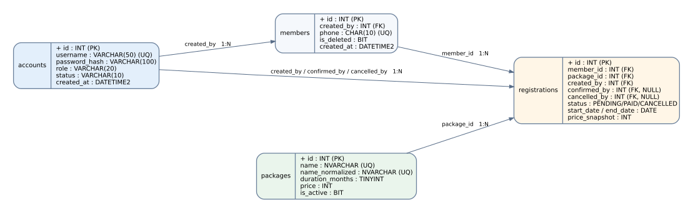
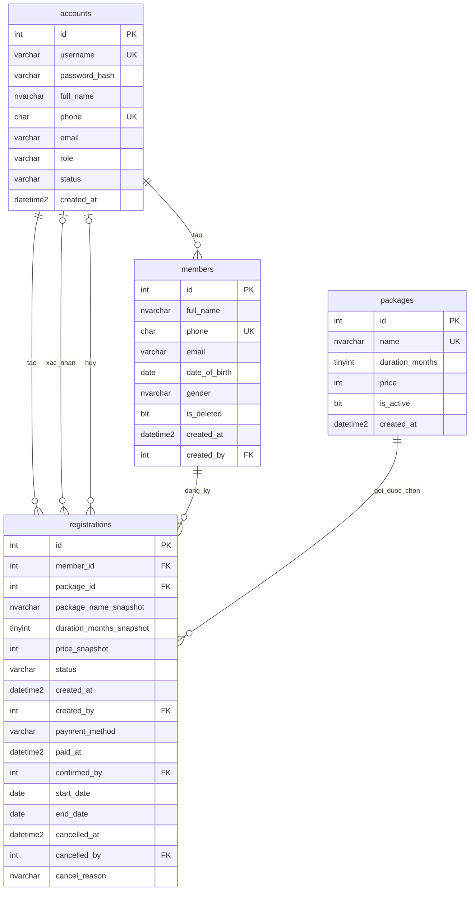

# THIẾT KẾ CƠ SỞ DỮ LIỆU — GYM MANAGEMENT SYSTEM

| Thuộc tính | Giá trị |
|---|---|
| Nguồn yêu cầu | `Software Requirement Specification.md` — **Baseline 2.0**, 26/10/2026 |
| Phiên bản thiết kế | **DD 2.2 — bản tiếng Việt**, 27/10/2026 (đồng bộ với `database/GymDB_Setup.sql`) |
| Cơ sở dữ liệu | Microsoft SQL Server 2022 |
| Ứng dụng | Java 21, Servlet/JSP, JDBC, Tomcat 10.1 |
| Đường dẫn | `docs/database/Database Design.md` |
| Script triển khai | `database/GymDB_Setup.sql` (một file: tạo `GymDB`, 4 bảng và dữ liệu mẫu) |
| Tình trạng | **Đã đối chiếu với `GymDB_Setup.sql`; chưa xác nhận bằng integration test** |

> **Dành cho lập trình viên và coding agent:** Chỉ có **4 bảng nghiệp vụ**: `accounts`, `members`, `packages`, `registrations`. Đây không phải tài liệu migration có thể chạy trực tiếp; script chạy được là `database/GymDB_Setup.sql`. Không lấy SQL cũ hoặc tài liệu R3 Baseline 1.x làm chuẩn. Mục nào ghi **ĐỀ XUẤT (chưa triển khai)** là hướng mở rộng, hiện chưa có trong script.

## 0. Quy ước và thứ tự ưu tiên

| Thứ tự | Nguồn | Phạm vi quyết định |
|---|---|---|
| 1 | SRS Baseline 2.0 | Phạm vi, CN/QT/DL/HL/CL/KT, phân quyền và nghiệm thu; **ưu tiên cao nhất về nghiệp vụ** |
| 2 | Tài liệu DD 2.1 này | Tên bảng/cột, kiểu lưu trữ, khóa, chỉ mục, thứ tự khóa transaction và những lựa chọn được chốt |
| 3 | `Skeleton Changelog.md` 26/10/2026 và skeleton Java tương ứng | Package, class, method signature và phân công DAO/Service; `TODO` chưa phải code hoạt động |
| 4 | SQL cũ, Database Design R3 | Tài liệu lịch sử, **không triển khai nguyên trạng** |

| Ký hiệu | Ý nghĩa |
|---|---|
| **BẮT BUỘC** | Yêu cầu Must bắt nguồn từ SRS |
| **ĐÃ CHỐT** | Quyết định thiết kế được xác nhận |
| **KHUYẾN NGHỊ** | Cách triển khai có thể thay bằng cách khác nếu chứng minh tương đương |
| **VÍ DỤ SQL** | Minh họa, phải tích hợp vào `CREATE TABLE` thực tế; không chạy như migration độc lập |

### 0.1. Mười quyết định thiết kế

| Mã | Quyết định | Quy tắc triển khai |
|---|---|---|
| DD-01 | Tên gói duy nhất bằng `UNIQUE(name)` với collation `Vietnamese_100_CI_AS` | Không có cột `name_normalized`; collation không phân biệt hoa/thường nên chặn tên chỉ khác hoa/thường. Khoảng trắng thừa do Service trim/gộp trước khi ghi |
| DD-02 | CHECK vòng đời `registrations` đầy đủ | Dữ liệu PENDING/PAID/CANCELLED loại trừ nhau; bắt buộc `IS NOT NULL` ở nhánh có dữ liệu |
| DD-03 | Chuẩn transaction/lock theo hội viên | Khóa `members` trước, rồi `packages` (nếu cần), sau đó mới đọc/ghi `registrations` |
| DD-04 | Thời gian nghiệp vụ do `AppClock` cấp | Không dùng `GETDATE()`/`SYSDATETIME()` làm mặc định cho tác vụ ứng dụng |
| DD-05 | DB bảo vệ cấu trúc, Service bảo vệ nghiệp vụ | PK/FK/UNIQUE/CHECK/index ở SQL; chuyển trạng thái và RBAC trong Service/DAO; không dùng trigger |
| DD-06 | `members.created_by` NOT NULL | Mỗi hồ sơ tạo mới phải gắn tài khoản có thật; không bịa tác nhân khi chuyển dữ liệu cũ |
| DD-07 | Đồng thời ngừng bán / tạo PENDING | CN-22 khóa `members`, rồi khóa dòng `packages`; CN-21 chỉ cập nhật `packages` |
| DD-08 | Seed chạy một lần trên database mới | `GymDB_Setup.sql` dùng `CREATE DATABASE` và `INSERT` trực tiếp, ID cố định theo thứ tự IDENTITY; muốn nạp lại phải xóa/tạo lại `GymDB`, không chạy chồng lên database đã có |
| DD-09 | Tránh bẫy `UNKNOWN` trong CHECK SQL | Có `IS NOT NULL` tường minh, nhất là `payment_method` của PAID |
| DD-10 | Không đánh đồng UNIQUE/CHECK với bất biến nghiệp vụ | Service chịu trách nhiệm snapshot, ngày gói không chồng lấn, bất biến trạng thái và tên chuẩn hóa |

### 0.2. Những gì **không có** trong Baseline 2.0

Không tạo các bảng `visits`, `plan_types`, `memberships`, `payment_transactions`, `audit_logs`, `visit_changes`, bảng role động hay bảng session. Không có vai trò `OWNER`/`ACCOUNTANT`, trường `paid_sequence`, `proof_image_path`, `end_exclusive`, `duration_unit`, `security_version`; không có check-in/out, thanh toán ngân hàng tự động, hoàn tiền, lựa chọn ngày bắt đầu thủ công hoặc PENDING tự hết hạn. **Một hàng `registrations` vừa là một lần mua vừa là giao dịch thanh toán của lần mua ấy.** Trạng thái gói của hội viên là dữ liệu tính ra, không lưu cột riêng.

## 1. Mô hình dữ liệu và ERD

### 1.1. Trách nhiệm của bốn bảng

| Bảng | Nội dung | Phân hệ | Nguồn |
|---|---|---|---|
| `accounts` | Tài khoản nhân viên, đăng nhập, hash mật khẩu, vai trò, trạng thái khóa | A — TV1 | DL-01, CN-01–10 |
| `members` | Hồ sơ hội viên, xóa mềm, người tạo | B — TV2 | DL-02, CN-11–17 |
| `packages` | Danh mục gói, thời hạn tháng, giá, đang bán/ngừng bán | C — TV3 | DL-03, CN-18–21 |
| `registrations` | Snapshot đăng ký, PENDING/PAID/CANCELLED, lịch hiệu lực và lý do hủy | C — TV3; D — TV4 | DL-04, CN-22–28 |

### 1.2. Quan hệ khóa ngoại

| Bảng cha | Bảng con | FK | Quan hệ |
|---|---|---|---|
| `accounts` | `members` | `members.created_by` | 1 → 0..N |
| `accounts` | `registrations` | `registrations.created_by` | 1 → 0..N |
| `accounts` | `registrations` | `registrations.confirmed_by` | 1 → 0..N; NULL nếu chưa PAID |
| `accounts` | `registrations` | `registrations.cancelled_by` | 1 → 0..N; NULL nếu chưa CANCELLED |
| `members` | `registrations` | `registrations.member_id` | 1 → 0..N |
| `packages` | `registrations` | `registrations.package_id` | 1 → 0..N |

### 1.3. Sơ đồ ERD sinh trực tiếp từ mã



**Mã nguồn sơ đồ:** [`Gym_Management_ERD_Baseline_2.0.dot`](Gym_Management_ERD_Baseline_2.0.dot). Sinh lại bằng `dot -Tsvg Gym_Management_ERD_Baseline_2.0.dot -o Gym_Management_ERD_Baseline_2.0.svg`. Sơ đồ mô tả thực thể và FK; bảng từ điển mục 3 và CHECK mục 4 mới là đặc tả đầy đủ về NULL và ràng buộc.

**Mermaid tương ứng** (dùng trong GitHub và cho agent chỉnh sửa):



Không lưu mã `HV000123` hay `DK000123` thành cột vật lý; Java định dạng từ `id`.

## 2. Quy ước lưu trữ

| Chủ đề | Quy tắc |
|---|---|
| Định danh | Bảng số nhiều, cột `snake_case`, khóa chính `INT IDENTITY(1,1)` |
| Tiền | `INT` đơn vị VND, giá từ 1 đến 100.000.000; `SUM(CAST(price_snapshot AS BIGINT))` để tránh tràn |
| Chuỗi | `NVARCHAR` cho tên, giới tính, lý do hủy; số điện thoại `CHAR(10)`, không phải số nguyên |
| Ngày | `DATE` cho ngày sinh, `start_date`, `end_date`; `DATETIME2(0)` cho mốc thời gian sự kiện |
| Múi giờ | Tính theo `Asia/Ho_Chi_Minh` tại Java; `DATETIME2` **không** lưu timezone |
| Boolean | `BIT NOT NULL` cho `members.is_deleted`, `packages.is_active` |
| Enum | `VARCHAR` và CHECK; Java dùng `Role`, `AccountStatus`, `RegistrationStatus`, `PaymentMethod` |
| Xóa | Không DELETE vật lý ở ứng dụng; không `ON DELETE CASCADE` |
| Session | `HttpSession`/`SessionUser`; cookie nhớ username, không có bảng session/cookie |
| Mật khẩu | Chỉ lưu hash trong `VARCHAR(100)`, không lưu mật khẩu gốc |
| So sánh username | Không phân biệt hoa/thường, cần cấu hình collation kiểm chứng được trên SQL Server |

**Quy tắc snapshot (QT-03):** Khi tạo PENDING, DAO lấy `name`, `duration_months`, `price` từ dòng `packages` **trong cùng transaction** để lưu `package_name_snapshot`, `duration_months_snapshot`, `price_snapshot`. Không tính lại snapshot sau khi đổi thông tin gói. Báo cáo doanh thu theo gói **GROUP BY `package_id` và hiển thị tên gói hiện hành** (QT-12), còn lịch sử đăng ký/biên nhận dùng snapshot.

## 3. Từ điển dữ liệu (schema mục tiêu)

### 3.1. Bảng `accounts` — DL-01

| Cột | Kiểu SQL | NULL | Quy tắc |
|---|---|---|---|
| `id` | `INT IDENTITY(1,1)` | Không | PK |
| `username` | `VARCHAR(50)` | Không | UNIQUE không phân biệt hoa/thường; regex `^[a-zA-Z][a-zA-Z0-9_]{3,49}$` ở Service (HL-08) |
| `password_hash` | `VARCHAR(100)` | Không | BCrypt cost ≥ 10 hoặc PBKDF2-HMAC-SHA256 có salt (CL-03) |
| `full_name` | `NVARCHAR(100)` | Không | 2–100 ký tự sau trim, không chứa chữ số (HL-01) |
| `phone` | `CHAR(10)` | Không | UNIQUE trong `accounts`; `^0[0-9]{9}$` (HL-03) |
| `email` | `VARCHAR(254)` | Có | Không bắt buộc, không UNIQUE; hợp lệ nếu nhập |
| `role` | `VARCHAR(20)` | Không | `ADMIN` / `MANAGER` / `RECEPTIONIST` |
| `status` | `VARCHAR(10)` | Không | `ACTIVE` / `LOCKED`; mặc định `ACTIVE` |
| `created_at` | `DATETIME2(0)` | Không | Từ `AppClock.now()` |

Không đổi username (CN-07). Chỉ ADMIN quản lý tài khoản, không tự khóa, tự đổi vai trò hoặc tự reset mật khẩu (QT-14). Không có `updated_at`, `is_deleted`, `deleted_at` hoặc `security_version`. Filter đọc trạng thái/vai trò hiện hành từ DB ở mỗi request bảo vệ, timeout session 30 phút (CN-03).

### 3.2. Bảng `members` — DL-02

| Cột | Kiểu SQL | NULL | Quy tắc |
|---|---|---|---|
| `id` | `INT IDENTITY(1,1)` | Không | PK; hiển thị `HV` + ít nhất 6 chữ số |
| `full_name` | `NVARCHAR(100)` | Không | HL-01 |
| `phone` | `CHAR(10)` | Không | UNIQUE **kể cả đã xóa mềm**; HL-02 |
| `email` | `VARCHAR(254)` | Có | HL-04, được trùng |
| `date_of_birth` | `DATE` | Có | 01/01/1900 ≤ ngày sinh ≤ `AppClock.today()` ở Service (HL-05) |
| `gender` | `NVARCHAR(10)` | Có | `N'Nam'`, `N'Nữ'`, `N'Khác'` |
| `is_deleted` | `BIT` | Không | Mặc định 0 |
| `created_at` | `DATETIME2(0)` | Không | Không thay đổi khi xóa/khôi phục |
| `created_by` | `INT` | Không (DD-06) | FK → `accounts.id`, bắt buộc đối với schema mới |

Không có `deleted_at`, `deleted_by`, `membership_status`, `expiry_date`. MANAGER xóa mềm khi không có PAID chưa hết hạn; hủy toàn bộ PENDING trong cùng transaction (QT-09). Khôi phục chỉ đặt `is_deleted=0`, không phục hồi CANCELLED (QT-10). RECEPTIONIST không được xem hội viên đã xóa (QT-11).

### 3.3. Bảng `packages` — DL-03

| Cột | Kiểu SQL | NULL | Quy tắc |
|---|---|---|---|
| `id` | `INT IDENTITY(1,1)` | Không | PK |
| `name` | `NVARCHAR(100)` | Không | Tên hiển thị, UNIQUE theo DL-03; collation `Vietnamese_100_CI_AS` (không phân biệt hoa/thường) |
| `duration_months` | `TINYINT` | Không | CHECK IN (1,3,6,12); không cho sửa sau tạo |
| `price` | `INT` | Không | CHECK BETWEEN 1 AND 100000000 |
| `is_active` | `BIT` | Không | Mặc định 1; 0 là ngừng bán, không hủy PENDING đã tạo |
| `created_at` | `DATETIME2(0)` | Không | Từ `AppClock.now()` |

**Chuẩn hóa tên ở Service:** trim khoảng trắng đầu/cuối, gộp khoảng trắng liên tiếp thành một dấu cách, kiểm tra độ dài 2–100 ký tự trước khi ghi; dùng chung một helper cho tạo và sửa gói. Chống trùng tên dựa vào `UNIQUE(name)` với collation `Vietnamese_100_CI_AS` (không phân biệt hoa/thường). DB không tự gộp khoảng trắng, nên chuẩn hóa này do Service/DAO bảo đảm (DD-05).

Nhiều gói có thể cùng thời hạn. PENDING gói đã ngừng bán vẫn được xác nhận (QT-04). **ĐỀ XUẤT (chưa triển khai):** nếu cần chặn chặt hơn các biến thể khoảng trắng/Unicode, thêm cột `name_normalized` với UNIQUE collation BIN2.

### 3.4. Bảng `registrations` — DL-04, DD-02

| Cột | Kiểu SQL | NULL | Quy tắc |
|---|---|---|---|
| `id` | `INT IDENTITY(1,1)` | Không | PK; hiển thị `DK` + ít nhất 6 chữ số |
| `member_id` | `INT` | Không | FK → `members.id` |
| `package_id` | `INT` | Không | FK → `packages.id` |
| `package_name_snapshot` | `NVARCHAR(100)` | Không | Tên gói tại thời điểm tạo PENDING |
| `duration_months_snapshot` | `TINYINT` | Không | CHECK IN (1,3,6,12); snapshot |
| `price_snapshot` | `INT` | Không | CHECK BETWEEN 1 AND 100000000; snapshot |
| `status` | `VARCHAR(10)` | Không | `PENDING` / `PAID` / `CANCELLED`; có thể DEFAULT `PENDING` |
| `created_at` | `DATETIME2(0)` | Không | Từ AppClock khi tạo |
| `created_by` | `INT` | Không | FK → `accounts.id` |
| `payment_method` | `VARCHAR(10)` | Có | `CASH` / `TRANSFER`; **chỉ có khi PAID** |
| `paid_at` | `DATETIME2(0)` | Có | Chỉ khi PAID; từ AppClock |
| `confirmed_by` | `INT` | Có | FK → `accounts.id`; chỉ khi PAID |
| `start_date` | `DATE` | Có | Ngày đầu hiệu lực, tính cả ngày; chỉ khi PAID |
| `end_date` | `DATE` | Có | Ngày cuối hiệu lực, tính cả ngày; ≥ `start_date`; chỉ khi PAID |
| `cancelled_at` | `DATETIME2(0)` | Có | Chỉ khi CANCELLED; từ AppClock |
| `cancelled_by` | `INT` | Có | FK → `accounts.id`; chỉ khi CANCELLED |
| `cancel_reason` | `NVARCHAR(255)` | Có | Chỉ khi CANCELLED; lý do 3–255 ký tự (HL-15), hoặc lý do hệ thống QT-09 |

| Trạng thái | Phương thức / paid_at / confirmed_by | Ngày bắt đầu / kết thúc | cancelled_at / cancelled_by / cancel_reason |
|---|---|---|---|
| PENDING | Tất cả NULL | Cả hai NULL | Tất cả NULL |
| PAID | Tất cả NOT NULL, phương thức hợp lệ | Cả hai NOT NULL, `end_date >= start_date` | Tất cả NULL |
| CANCELLED | Tất cả NULL | Cả hai NULL | Tất cả NOT NULL |

**Chỉ được chuyển** `PENDING → PAID` hoặc `PENDING → CANCELLED` (QT-02). CHECK xác nhận **hình dạng của hàng sau cập nhật**, không chặn được thao tác trái phép chuyển một hàng PAID sang trạng thái hợp lệ khác; Service/DAO phải chặn (DD-05). Với hủy thủ công, Service kiểm tra độ dài lý do sau trim; với xóa mềm dùng lý do cố định `Xóa hồ sơ hội viên`.

## 4. Ràng buộc SQL và chỉ mục

### 4.1. Ma trận constraint

| Bảng | PK | UNIQUE | CHECK / FK |
|---|---|---|---|
| `accounts` | `id` | `username` không phân biệt hoa/thường, `phone` | role, status; định dạng SĐT do Service kiểm tra |
| `members` | `id` | `phone` không lọc `is_deleted` | gender, FK created_by; định dạng SĐT do Service kiểm tra |
| `packages` | `id` | `name` (collation `Vietnamese_100_CI_AS`) | thời hạn 1/3/6/12, giá 1–100 triệu |
| `registrations` | `id` | Không có UNIQUE nghiệp vụ | FK member, package, 3 actor; snapshot hợp lệ; CHECK vòng đời liên cột |

Script hiện **không** có CHECK định dạng SĐT; `^0[0-9]{9}$` (HL-03) do Service kiểm tra, và không dựa vào `CHAR(10)` để bảo đảm toàn chữ số. Các CHECK/UNIQUE/FK trong script để tên do SQL Server tự sinh. **ĐỀ XUẤT (chưa triển khai)** — ví dụ SQL nếu muốn DB tự chặn:

```sql
CHECK (
  phone COLLATE Latin1_General_BIN2
  LIKE '0[0-9][0-9][0-9][0-9][0-9][0-9][0-9][0-9][0-9]'
)
```

Mọi cột bắt buộc cần `NOT NULL`, vì `CHECK` trong SQL Server có thể cho phép biểu thức trả về `UNKNOWN`.

### 4.2. CHECK liên cột cho vòng đời đăng ký

Trong script, CHECK này được khai báo trực tiếp trong `CREATE TABLE dbo.registrations` (không đặt tên):

```sql
CONSTRAINT CK_Registrations_Lifecycle CHECK (
    (status = 'PENDING'
        AND payment_method IS NULL AND paid_at IS NULL AND confirmed_by IS NULL
        AND start_date IS NULL AND end_date IS NULL
        AND cancelled_at IS NULL AND cancelled_by IS NULL AND cancel_reason IS NULL)
 OR (status = 'PAID'
        AND payment_method IS NOT NULL
        AND payment_method IN ('CASH', 'TRANSFER')
        AND paid_at IS NOT NULL AND confirmed_by IS NOT NULL
        AND start_date IS NOT NULL AND end_date IS NOT NULL
        AND end_date >= start_date
        AND cancelled_at IS NULL AND cancelled_by IS NULL AND cancel_reason IS NULL)
 OR (status = 'CANCELLED'
        AND payment_method IS NULL AND paid_at IS NULL AND confirmed_by IS NULL
        AND start_date IS NULL AND end_date IS NULL
        AND cancelled_at IS NOT NULL AND cancelled_by IS NOT NULL
        AND cancel_reason IS NOT NULL AND LEN(LTRIM(RTRIM(cancel_reason))) BETWEEN 3 AND 255)
)
```

Phải khai báo `status NOT NULL` riêng. Đặc biệt, nhánh PAID **phải** có `payment_method IS NOT NULL` ngoài `IN ('CASH','TRANSFER')`. SQL CHECK không bảo đảm snapshot đúng với bản ghi gói **ở thời điểm tạo** và không chặn sửa quá khứ thành một trạng thái cuối khác vẫn hợp lệ.

### 4.3. Chỉ mục

**Đã có trong script** (index tự sinh từ UNIQUE, tên do SQL Server đặt): `accounts.username`, `accounts.phone`, `members.phone`, `packages.name`.

| Chỉ mục | Cột | Chức năng | Ghi chú |
|---|---|---|---|
| `UX_accounts_username` | `username` UNIQUE | CN-01, CN-06 | Collation không phân biệt hoa/thường |
| `UX_accounts_phone` | `phone` UNIQUE | CN-06 | Phạm vi riêng accounts |
| `UX_members_phone` | `phone` UNIQUE | CN-12/14 | Gồm cả hội viên xóa mềm |
| `UX_packages_name` | `name` UNIQUE | CN-19/20 | Theo DL-03 |

**ĐỀ XUẤT (chưa triển khai)** — các chỉ mục hỗ trợ truy vấn, script hiện chưa tạo; thêm khi workload cần:

| Chỉ mục | Cột | Chức năng | Ghi chú |
|---|---|---|---|
| `IX_members_created_at_id` | `(created_at DESC, id DESC)` | CN-11, CN-28 | Phân trang ổn định |
| `IX_registrations_member_status_end` | `(member_id, status, end_date)` | QT-05/07/08/09 | Lịch PAID và lịch sử |
| `IX_registrations_paid_at` | `(paid_at) INCLUDE(price_snapshot, package_id)` | CN-26/27 | Có thể filtered `WHERE status='PAID'` |
| `IX_registrations_created_at_id` | `(created_at DESC, id DESC)` | CN-24 | Trục thời gian tạo |
| `IX_registrations_package_status` | `(package_id, status)` | CN-24 | Chỉ thêm nếu workload thực tế cần |

Tra cứu `LIKE '%keyword%'` theo họ tên thường không tận dụng được index B-tree để seek. Với quy mô demo 100+ hội viên, scan kèm phân trang có thể chấp nhận. Phân trang `ORDER BY ..., id ... OFFSET ? ROWS FETCH NEXT ? ROWS ONLY`, truy vấn COUNT tương ứng (CL-09). Không nối trực tiếp giá trị sort, `%`, `_`, `[` từ người dùng vào SQL; bind tham số và escape wildcard nếu tìm khớp ký tự.

### 4.4. Thứ tự tạo bảng

| Bước | Thao tác | Lý do |
|---|---|---|
| 1 | Tạo `accounts` | Không phụ thuộc FK |
| 2 | Tạo `members` | FK đến accounts |
| 3 | Tạo `packages` | Không phụ thuộc FK |
| 4 | Tạo `registrations` | FK đến members, packages, accounts |
| 5 | `INSERT` dữ liệu mẫu theo thứ tự `accounts` → `packages` → `members` → `registrations` | Cùng trong `GymDB_Setup.sql`; muốn chỉ tạo cấu trúc thì chạy đến hết `CREATE TABLE` |
| 6 | (ĐỀ XUẤT) Tạo index ngoài PK/UNIQUE | Chưa có trong script |

Không dùng `ON DELETE CASCADE`, trigger, cột trạng thái gói tính sẵn hoặc `paid_sequence`. UNIQUE thông thường không ngăn các khoảng ngày gói chồng lấn; transaction mục 5 xử lý.

## 5. Transaction, khóa và vòng đời nghiệp vụ

### 5.1. Quy trình khóa chuẩn — DD-03, QT-06

| Bước | Yêu cầu |
|---|---|
| 1 | `DBContext.getConnection()` lấy connection mới; Service gọi `setAutoCommit(false)` |
| 2 | Khóa dòng hội viên: `SELECT ... FROM members WITH (UPDLOCK, HOLDLOCK) WHERE id=?` trên **cùng connection** |
| 3 | Kiểm tra lại tồn tại, `is_deleted`, trạng thái package/registration ngay trong transaction |
| 4 | Nếu cần khóa gói, thực hiện sau members; thao tác registrations **sau** khóa members; cập nhật trạng thái bằng `WHERE id=? AND status='PENDING'` |
| 5 | Chỉ thành công khi đúng 1 hàng bị UPDATE; ghi toàn bộ rồi `commit`; lỗi bất kỳ thì `rollback` và đóng connection |

**Thứ tự khóa thống nhất:** `members → packages (nếu cần) → registrations`. Không giữ lock của `registrations` rồi chờ lock `members`, không giữ lock `packages` rồi quay lại lock `members`. Trong transaction không render JSP, gọi HTTP hay băm mật khẩu. SQL Server vẫn có thể deadlock (1205): rollback đầy đủ, báo lỗi có thể thử lại hoặc retry **toàn bộ transaction** với số lần giới hạn và connection mới; không retry riêng UPDATE cuối.

### 5.2. Tạo đăng ký PENDING — CN-22

| Thứ tự | Xử lý |
|---|---|
| 1 | BEGIN transaction, khóa `members` theo `member_id` |
| 2 | Hội viên phải tồn tại, `is_deleted=0` |
| 3 | Khóa dòng `packages` bằng `WITH (UPDLOCK, HOLDLOCK)`, xác nhận `is_active=1` (DD-07) |
| 4 | Dùng dữ liệu tên, tháng, giá từ `packages`; lấy `created_at=AppClock.now()` |
| 5 | INSERT `registrations` với snapshot, `status='PENDING'`, `created_by` |
| 6 | Các cột thanh toán/lịch/hủy NULL; COMMIT |

CN-21 ngừng/mở bán chỉ sửa dòng packages, không đợi lock members. Nhờ vậy, tạo PENDING hoặc thấy gói đang bán và hoàn tất trước ngừng bán, hoặc thấy đã ngừng và bị từ chối. **Không** tin giá/thời hạn từ biểu mẫu HTML.

### 5.3. Xóa mềm hội viên — CN-15, QT-09

```text
BEGIN TRANSACTION
  Khóa members theo id (UPDLOCK, HOLDLOCK)
  Yêu cầu hồ sơ tồn tại và chưa xóa
  Nếu tồn tại registrations (status='PAID' AND end_date >= AppClock.today()):
      ROLLBACK; từ chối xóa
  UPDATE members SET is_deleted=1 WHERE id=? AND is_deleted=0
  UPDATE registrations
    SET status='CANCELLED', cancelled_at=AppClock.now(),
        cancelled_by=managerId, cancel_reason=N'Xóa hồ sơ hội viên'
    WHERE member_id=? AND status='PENDING'
COMMIT
```

Giữ nguyên PAID đã hết hạn. Nếu còn PAID đang/chờ hiệu lực thì không thay đổi gì. Khi khôi phục chỉ cập nhật `is_deleted=0`, không mở lại đăng ký CANCELLED.

### 5.4. Hủy đăng ký PENDING — CN-23

Đầu tiên đọc `member_id` để biết hội viên cần khóa, **không giữ lock đăng ký** khi chuyển sang khóa `members`; sau đó đọc lại đăng ký trong transaction và kiểm tra `member_id` không thay đổi. Thực hiện:

```sql
UPDATE registrations
SET status = 'CANCELLED',
    cancelled_at = ?, cancelled_by = ?, cancel_reason = ?
WHERE id = ? AND member_id = ? AND status = 'PENDING';
```

`rowsAffected=1` mới thành công; 0 dòng là `Đăng ký không còn chờ thanh toán` (hoặc không tìm thấy ID). PAID và CANCELLED không sửa/hủy qua chức năng này.

### 5.5. Xác nhận PAID — CN-25, QT-05/06

| Giai đoạn | Quy tắc |
|---|---|
| GET — rà soát | Chỉ hiển thị snapshot và **ngày dự kiến**, không giữ chỗ hoặc đổi DB |
| POST — xác nhận | Chỉ nhận ID và `CASH`/`TRANSFER`; đọc lại DB, tính lại ngày sau khi khóa member |
| Transaction | Khóa member → kiểm tra chưa xóa → đọc lại PENDING → MAX `end_date` của PAID → tính lịch → UPDATE có điều kiện → COMMIT |
| Sau khi thành công | Hiển thị **ngày đã lưu thực tế**, không khẳng định preview trước đó luôn đúng |

```text
start_date = max(AppClock.today(), max(end_date của PAID) + 1 ngày)
end_date = start_date.plusMonths(duration_months_snapshot).minusDays(1)
```

Nếu chưa có PAID thì bỏ vế `max(end_date)+1`. Ngày kết thúc **tính cả ngày**. Dùng `LocalDate.plusMonths` của Java; không tự thay bằng SQL `DATEADD` nếu chưa kiểm chứng tương đương ở cuối tháng.

| Tình huống (hôm nay 24/10/2026) | Tháng | Bắt đầu | Hết hạn (tính cả ngày) |
|---|---:|---|---|
| Chưa có PAID | 1 | 24/10/2026 | 23/11/2026 |
| PAID trước hết 10/09/2026 | 3 | 24/10/2026 | 23/01/2027 |
| PAID trước hết 31/10/2026 | 1 | 01/11/2026 | 30/11/2026 |
| Gói bắt đầu sau PAID hết 30/01/2027 | 1 | 31/01/2027 | 27/02/2027 |
| Gói nối tiếp dòng trên | 1 | 28/02/2027 | 27/03/2027 |

Hai yêu cầu xác nhận cùng ID: chỉ một UPDATE từ PENDING thành PAID thành công. Hai PENDING khác nhau cùng hội viên: member lock nối tiếp hóa việc tính lịch. Đồng thời xóa mềm/xác nhận cũng được kiểm tra trong cùng cơ chế khóa. Không nhận `start_date`, `end_date`, tiền hay snapshot từ client.

## 6. Thời gian, tình trạng gói và báo cáo

### 6.1. Đồng hồ nghiệp vụ — DD-04, QT-15

| Giá trị | Cách lấy |
|---|---|
| `created_at`, `paid_at`, `cancelled_at` | `AppClock.now()` trong Service; ghi vào `DATETIME2(0)` |
| `today` | `AppClock.today()` theo `Asia/Ho_Chi_Minh` |
| Khoảng ngày A..B | `[A 00:00, (B+1) 00:00)` |
| Mặc định bộ lọc | Tháng hiện tại (QT-13) |
| Seed demo | Ngày mẫu cố định theo mốc 27/10/2026; không dùng làm quy tắc runtime |

### 6.2. Tính tình trạng hội viên — QT-07/08

| Mức ưu tiên | Trạng thái tính ra | Điều kiện |
|---:|---|---|
| 1 | Đang hiệu lực | Có PAID với `start_date <= today <= end_date` |
| 2 | Chờ hiệu lực | Không có gói đang hiệu lực, có PAID với `start_date > today` |
| 3 | Hết hạn | Có PAID, nhưng mọi PAID đã có `end_date < today` |
| 4 | Chưa có gói | Không có PAID |

Ngày hết hạn hiển thị bằng `MAX(end_date)` của mọi PAID. Danh sách sắp hết hạn gồm hội viên **chưa xóa mềm**, đang hiệu lực và `MAX(end_date)` trong `[today, today+6 ngày]` (còn 1–7 ngày tính cả hôm nay). Nếu đã mua gói nối tiếp, `MAX(end_date)` nằm xa hơn nên không cảnh báo. PENDING không được tính gia hạn.

### 6.3. Truy vấn báo cáo — QT-12/13

| Truy vấn | Lọc | Kết quả |
|---|---|---|
| Đăng ký theo ngày tạo (CN-24) | Mọi status; `created_at >= from AND created_at < toExclusive` | Danh sách 20 dòng/trang |
| Đăng ký theo ngày thanh toán (CN-24) | PAID; `paid_at >= from AND paid_at < toExclusive` | Danh sách 20 dòng/trang |
| Doanh thu ngày/tháng (CN-26) | PAID, `paid_at` trong kỳ | COUNT, `SUM(CAST(price_snapshot AS BIGINT))`, dòng tổng |
| Doanh thu theo gói (CN-27) | Cùng bộ lọc PAID và kỳ | GROUP BY `package_id`, hiển thị `packages.name` hiện hành, doanh thu, tỷ trọng |
| Tổng quan hội viên (CN-28) | `members.is_deleted` + lịch PAID theo hôm nay | Số hồ sơ quản lý/đã xóa, số người đang hiệu lực/sắp hết hạn; COUNT DISTINCT |
| Hội viên mới (CN-28) | `members.created_at` trong kỳ | Tính cả hồ sơ sau đó đã xóa mềm |

Nếu không có doanh thu, `COALESCE(SUM(...),0)`. Tổng CN-26 và CN-27 **phải bằng nhau** trong cùng khoảng ngày. Không `GROUP BY package_name_snapshot` khi báo cáo theo gói; không tính PENDING/CANCELLED vào doanh thu.

## 7. Đối chiếu với Skeleton Baseline 2.0

| Phân hệ | Java class/DAO | Bảng và trách nhiệm |
|---|---|---|
| A — `account` | `model.account.Account`, `AccountDAO`, `AuthService`, `AccountService` | `accounts`: đăng nhập, tìm, tạo/sửa, khóa, đổi/reset mật khẩu |
| B — `member` | `model.member.Member`, `MemberDAO`, `MembershipStatusService` | `members`, truy vấn `registrations`: phân trang, xóa/khôi phục, tính trạng thái |
| C — `registration` | `model.registration.GymPackage`, `Registration`, `PackageDAO`, `RegistrationDAO` | `packages`, `registrations`: tạo/hủy PENDING, snapshot, truy vấn lịch |
| D — `payment` | `PaymentService`, `ReportDAO`, `ReportService`, `SchedulePreview`, `RevenueRow`, `MemberOverview` | Xác nhận PAID và báo cáo từ registrations + JOIN; không bảng payment riêng |

| Giao diện DAO/Service liên quan | Hợp đồng |
|---|---|
| `DBContext.getConnection()` | Trả connection mới mỗi lần |
| `MemberDAO.lockForUpdate(conn, memberId)` | Khóa member trên connection của Service |
| `RegistrationDAO.cancelAllPending(conn, memberId, byId, reason)` | Hủy PENDING trong transaction của caller |
| `RegistrationDAO.hasUnexpiredPaid(conn, memberId, today)` | Kiểm tra chặn xóa mềm |
| `RegistrationDAO.findByMember(memberId)` | Lịch sử của hội viên |
| `MembershipStatusService.statusOf(memberId)` | Trạng thái suy ra |
| `MembershipStatusService.expiringSoon()` | Danh sách cảnh báo |
| `PaymentService.previewSchedule(regId)` | Preview chỉ đọc |
| `PaymentService.confirm(regId, method, byId)` | Xác nhận và tính lịch trong transaction |

**Service quản lý transaction và truyền cùng Connection xuống DAO.** Không được để DAO con mở connection riêng giữa CN-15/CN-25. `SessionUser` thuộc `HttpSession`, `AuthFilter` đọc account mỗi request; `/admin`, `/manager`, `/staff` là quy tắc URL/backend, không phải bảng dữ liệu.

## 8. Seed và chuyển đổi dữ liệu

### 8.1. Điều kiện dữ liệu mẫu — DL-05

| Bảng | Tối thiểu | Dữ liệu bắt buộc |
|---|---:|---|
| `accounts` | 6 | Mỗi vai trò ADMIN/MANAGER/RECEPTIONIST có 2; ít nhất 1 LOCKED; mật khẩu seed phải là hash thật |
| `packages` | 5 | Có cả thời hạn 1/3/6/12 tháng; ít nhất 1 ngừng bán; tên không trùng (không phân biệt hoa/thường) |
| `members` | 100 | Ít nhất 8 đã xóa mềm; tạo trải trong 6 tháng |
| `registrations` | 150 | PENDING/PAID/CANCELLED, CASH/TRANSFER, dữ liệu trải 6 tháng; lịch PAID hợp lệ và không chồng lấn; đủ các tình huống chưa mua/hiệu lực/sắp hết/chờ/hết hạn/nối tiếp |

**DD-08 — seed một lần:** `GymDB_Setup.sql` dành cho database mới: `CREATE DATABASE GymDB` rồi `INSERT` trực tiếp (không vòng lặp, không biến), nên chạy lần hai sẽ lỗi. Muốn nạp lại, xóa/tạo lại `GymDB`; không chạy chồng lên dữ liệu thật. Ngày mẫu cố định theo mốc 27/10/2026, không dùng làm quy tắc runtime. Mật khẩu demo `GymDemo@2026` chỉ lưu dưới dạng hash PBKDF2 (`pbkdf2$600000$salt$hash`). Không disable constraint để lách dữ liệu seed lỗi. FK người tạo/xác nhận/hủy phải trỏ tới tài khoản có thật; hội viên xóa mềm không có PENDING hoặc PAID chưa hết hạn. **ĐỀ XUẤT (chưa triển khai):** bản seed idempotent dùng khóa fixture ổn định với `NOT EXISTS`.

### 8.2. Ranh giới chuyển đổi từ Baseline 1.x

| Dữ liệu cũ | Thiết kế 2.0 | Ghi chú |
|---|---|---|
| `plan_types` | `packages` | Tháng 1/3/6/12, có `is_active` |
| `memberships` + `payment_transactions` | `registrations` | Một hàng duy nhất, snapshot và vòng đời |
| `visits` | Loại khỏi phạm vi | Không import vào schema mới |
| Role `OWNER`, `ACCOUNTANT` | Không tồn tại | Không tự gán sang role mới |
| `end_exclusive` | `start_date` / `end_date` gồm cả ngày cuối | Phải đánh giá kỹ dữ liệu trước chuyển |
| Hash/password/phone cũ | Quy tắc HL-03 và PasswordUtil mới | Kiểm tra tương thích |

Với database local/demo có thể tái tạo sau khi backup dữ liệu cần giữ. **Không có migration production an toàn tự động** trong tài liệu này; nếu có dữ liệu thật phải viết kế hoạch mapping, rollback và xin phê duyệt riêng.

## 9. Danh sách kiểm thử bắt buộc trước merge

| Nhóm | Điều kiện cần chứng minh |
|---|---|
| Schema | Đúng 4 bảng, mọi cột/kiểu/NULL/PK/FK/UNIQUE/CHECK khớp mục 3–4 |
| Username/SĐT | Username khác hoa thường không trùng; SĐT 10 số bắt đầu 0 (Service kiểm tra, DB chưa có CHECK); account và member có UNIQUE riêng; member xóa mềm không được dùng trùng số |
| Package | Tên chỉ khác hoa/thường bị `UNIQUE(name)` chặn; Service trim/gộp khoảng trắng bằng helper chung cho create/update; kiểm tra độ dài 2–100 |
| CHECK | Từ chối trạng thái/role/duration/price sai và mọi tổ hợp sai của registrations; **PAID với payment_method=NULL phải bị từ chối** |
| Snapshot | Giá/tên/tháng được chụp tại INSERT; sửa package không đổi registration cũ |
| Concurrency | Tạo PENDING đồng thời ngừng bán; 2 PAID cùng member; 2 tab PAID cùng ID; PAID đồng thời xóa mềm; không có đảo thứ tự lock |
| Lịch | Các ví dụ cuối tháng QT-05; `end_date` bao gồm ngày cuối; không chồng lấn/không gap khi nối tiếp |
| Hủy/xóa | Xóa mềm tự hủy PENDING nguyên tử; chặn khi PAID còn hạn; CANCELLED không khôi phục khi phục hồi member |
| Báo cáo | Chỉ đếm PAID theo `paid_at`; nhóm `package_id`; tổng CN-26=CN-27; COUNT DISTINCT member |
| Thời gian | Khoảng ngày có đủ ngày kết thúc và không tính 00:00 ngày sau; AppClock không phụ thuộc DB clock |
| Seed | Chạy trên database mới không lỗi; đạt ngưỡng DL-05; quan hệ FK, trạng thái, lịch không sai |
| DAO | ResultSet và chữ ký Java khớp skeleton; không còn bảng/cột Baseline 1.x |

**Các điều kiện trên là checklist nghiệm thu, chưa phải kết quả đã test.**

## 10. Chỉ mục truy vết yêu cầu

| Nhóm yêu cầu | Mã SRS | Mục tài liệu |
|---|---|---|
| 4 bảng, khóa, seed | DL-01–DL-05 | 1, 3, 4, 8 |
| Validation | HL-01–HL-17 | 2–4, 7 |
| Trạng thái đăng ký | QT-02, CN-23, CN-25 | 3.4, 4.2, 5 |
| Snapshot và bán gói | QT-03/04 | 2, 3.3, 5.2 |
| Lịch hiệu lực | QT-05 | 5.5 |
| Transaction và concurrent | QT-06, CL-06, KT-23 | 5 |
| Tình trạng / cảnh báo hết hạn | QT-07/08 | 6.2 |
| Xóa/khôi phục | QT-09–11, QT-16 | 3.2, 5.3 |
| Doanh thu, khoảng ngày | QT-12/13 | 6.3 |
| Account/session/clock | QT-14/15/17, CN-01–10 | 3.1, 6.1, 7 |
| Kiến trúc và phân trang | CL-01/02/09/10 | 4.3, 7 |

### Hướng dẫn cuối cho coding agent

**Triển khai đúng SRS 2.0, không tự phục hồi chức năng Baseline 1.x.** Script thực thi là `database/GymDB_Setup.sql`; khi đổi schema phải cập nhật đồng thời script và tài liệu này, không chạy nội dung Markdown như migration. Chỉ có bốn bảng, giữ nguyên method signature từ skeleton, các transaction dùng cùng JDBC Connection. Nếu phát hiện mâu thuẫn nghiệp vụ với SRS, trích đúng mã và nêu ra để review thay vì lặng lẽ chọn cách sửa. Các quyết định DD-01 đến DD-10 đã được chốt trong tài liệu; không cần hỏi lại.
